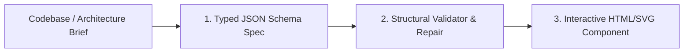

# The Archify Interactive AI Diagrams Engine

> **Origin**: Consolidated from `tt-a1i/archify`.
> **Directive**: Replaces primitive, static Mermaid or ASCII blocks with self-contained, interactive HTML/SVG technical diagrams featuring dark/light theme switching, node focus, and trace-route signal flow animations.

---

## 1. Supported Diagram Taxonomies

1. **Architecture Diagrams**: System microservices, boundaries, deployment topologies, and third-party integrations.
2. **Workflow Pipelines**: CI/CD deployment pipelines, automated approval queues, and operational runbooks.
3. **Sequence Diagrams**: API request/response lifecycles, authentication handshakes, and distributed async queues.
4. **Data-Flow Diagrams**: Ingestion pipelines, ETL/ELT transformations, and analytical data lineage.
5. **Lifecycle State Machines**: State transitions, error retry loops, circuit breakers, and terminal resolutions.

---

## 2. The Validate-Preview-Deliver Cycle

Unlike raw LLM SVG generation (which frequently yields overlapping lines, clipped labels, or broken syntax), the Archify pipeline enforces a three-stage validation gate:



### Stage 1: The Intermediate Typed Diagram Schema
The AI outputs a structured JSON specification:

```json
{
  "diagramType": "architecture",
  "theme": "dark",
  "nodes": [
    { "id": "client", "label": "Client Application (Next.js)", "type": "frontend", "status": "active" },
    { "id": "edge", "label": "Cloudflare Edge Router", "type": "gateway", "status": "active" },
    { "id": "api", "label": "Core API & Auth Guard", "type": "service", "status": "active" },
    { "id": "db", "label": "PostgreSQL (Supabase)", "type": "database", "status": "active" }
  ],
  "edges": [
    { "from": "client", "to": "edge", "label": "HTTPS / TLS 1.3", "animated": true },
    { "from": "edge", "to": "api", "label": "Internal RPC", "animated": true },
    { "from": "api", "to": "db", "label": "Connection Pool (BOLA Checked)", "animated": false }
  ]
}
```

### Stage 2: Structural Validation Gate
The validator inspects the schema:
- Verifies that all edge `from` and `to` targets correspond to valid node IDs.
- Verifies that node labels do not exceed length limits to avoid visual clipping.
- Confirms DAG (Directed Acyclic Graph) integrity for workflows and pipelines.

### Stage 3: Rendered Interactive Delivery
Outputs an accessible, self-contained SVG/HTML component with:
- **Theme Adaptability**: Automatically binds to `--background`, `--card`, `--border`, and `--primary`.
- **Signal Flow Traces**: Animated dashed strokes representing live data traversing the network.
- **Node Focusing**: Hovering over a node highlights all connected upstream and downstream edges.

---

## 3. Global Skill Installation

To enable Archify in your agent environment:
```bash
npx skills add tt-a1i/archify -g
```
