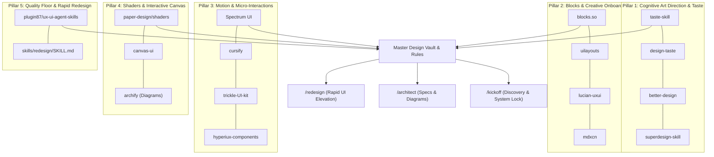

# SPEC-0001: Master Visual Intelligence & UI Redesign Engine (Evergreen High-Agency Aesthetic Architecture)

- **Status**: Proposed
- **Author**: Silicon Valley Principal Software Engineer & Creative Director
- **Target Repository**: `Adebayo0001/my-devop-tools` (`C:\Users\user\Desktop\My DevOp Tools`)
- **Date**: 2026-10-14
- **Applies To**: Global DevOps Tools Suite, Design Vault, Antigravity IDE, Claude Code, Cursor, Windsurf
- **Consolidated Repositories (16 Total)**:
  1. `Leonxlnx/taste-skill`
  2. `shadcn-labs/mdxcn`
  3. `tt-a1i/archify`
  4. `ui.spectrumhq.in`
  5. `ephraimduncan/blocks`
  6. `superdesigndev/superdesign-skill`
  7. `marvkr/better-design`
  8. `madebymustafa/design-taste`
  9. `DavidHDev/canvas-ui`
  10. `paper-design/shaders`
  11. `ui-layouts/uilayouts`
  12. `Hyperiux-Immersion-Labs/hyperiux-components`
  13. `ui-layouts/cursify`
  14. `akaieuan/trickle-UI-kit`
  15. `Seokwoooo/lucian-uxui`
  16. `plugin87/ux-ui-agent-skills`

---

## 1. Executive Summary

This architecture establishes the **Master Visual Intelligence & UI Redesign Engine** for the Universal Agentic Engineering Suite. While our engineering system has achieved enterprise-grade excellence in zero-trust security, strict test gates, and single-knob CSS cascading, frontend outputs can still suffer from:
1. **Uneven Spatial Rhythms**: Awkward padding offsets, misaligned margins, and visual density mismatches.
2. **Generic Onboarding & Intake Flows**: Sterile vertical column stacks lacking creative agency-grade storytelling (as identified in `mynd-mark`).
3. **Absence of Orchestrated Motion**: Static interfaces lacking physics-based micro-interactions, custom cursors, and ambient shaders.
4. **Lack of a Rapid UI Redesign Skill**: The need for a dedicated `/redesign` command capable of elevating an existing, logically functional user interface in 5–15 minutes under a 100% **Logic Freeze** without touching backend queries, state machines, or data contracts.

This specification consolidates **16 world-class open-source design repositories and agent skills** into **5 Cohesive Architectural Pillars**, delivering unprecedented visual fidelity, mathematical spatial accuracy, and rapid surgical UI execution.

---

## 2. 100% Requirement Ingestion Matrix (Anti-Lossy Traceability)

| Detail # | User-Explained Requirement & External Resource | Implementation Target | Acceptance Criterion |
|---|---|---|---|
| **D-1** | **Eradicate Uneven Spaces & AI Tells**: Fix uneven vertical/horizontal spacing, arbitrary paddings, and the "AI-generated" look. | `design-vault/taste-spatial-calculus.md`, `high-end-web-design-rules.md` | `AC-1` |
| **D-2** | **Logically Active & Intelligent Layouts**: Layouts must anticipate user mental models and reduce cognitive friction. | `skills/architect/SKILL.md`, `skills/redesign/SKILL.md` | `AC-2` |
| **D-3** | **Creative Agency Onboarding & Intake**: Elevate intake flows from sterile forms into high-converting, creative multi-pane experiences. | `design-vault/archetypes/ONBOARD-CREATIVE-agency-flows.md` | `AC-3` |
| **D-4** | **Fluid Motion & Animation Suite**: Micro-animations, spring-physics transitions, border glows, and orchestrated reveals. | `design-vault/motion-registry.md` | `AC-4` |
| **D-5** | **`Leonxlnx/taste-skill`**: Art direction inference, 3 taste dials (Variance, Density, Motion), and visual browser self-checks. | `skills/redesign/SKILL.md`, `design-vault/taste-spatial-calculus.md` | `AC-5` |
| **D-6** | **`shadcn-labs/mdxcn`**: 30+ free copy-and-paste markdown/MDX components (steps, timelines, terminals, callouts). | `design-vault/mdxcn-components.md` | `AC-6` |
| **D-7** | **`tt-a1i/archify`**: Interactive, self-contained architecture, sequence, and workflow diagrams with JSON-to-SVG validation. | `design-vault/diagrams-engine.md`, `skills/architect/SKILL.md` | `AC-7` |
| **D-8** | **`ui.spectrumhq.in`**: 250+ animated React components (Tailwind + Motion + shadcn) and direct MCP server integration. | `design-vault/motion-registry.md`, MCP configuration | `AC-8` |
| **D-9** | **`ephraimduncan/blocks` (blocks.so)**: 80+ open-source Shadcn React blocks via remote registry `@blocks-so`. | `design-vault/blocks-registry.md`, `components.json` | `AC-9` |
| **D-10** | **NON-DESTRUCTIVE INVARIANT**: Zero disruption to existing working tools, skills, zero-trust security invariants, or test gates. | Target Blast Radius & Protected Surface Lock | `AC-10` |
| **D-11** | **Standalone Rapid `/redesign` Skill**: Surgical UI elevation in 5–15 minutes under a 100% Logic Freeze. | `skills/redesign/SKILL.md`, `sync-skills.ps1` (Skill #14) | `AC-11` |
| **D-12** | **`superdesigndev/superdesign-skill`**: Context-aware UI/UX design, infinite visual canvas iteration, slide decks, and marketing graphics. | `design-vault/superdesign-canvas.md`, `skills/architect/SKILL.md` | `AC-12` |
| **D-13** | **`marvkr/better-design`**: Design MCP server with brand-grade design systems (Linear, Stripe, Vercel, Notion, Apple) & WCAG audit rules. | `design-vault/brand-design-systems.md`, MCP config | `AC-13` |
| **D-14** | **`madebymustafa/design-taste`**: Structured genre identities, typography hierarchy, color theory constraints, and component states. | `high-end-web-design-rules.md`, `design-vault/taste-spatial-calculus.md` | `AC-14` |
| **D-15** | **`DavidHDev/canvas-ui`**: Accessible WebGL/WebGPU surface layers (fluid simulations, glass refractions over clickable real DOM elements). | `design-vault/canvas-ui-surfaces.md` | `AC-15` |
| **D-16** | **`paper-design/shaders`**: Zero-dependency HTML canvas shaders (mesh gradients, dithering, dot orbits, liquid animations) via React. | `design-vault/shaders-and-backgrounds.md` | `AC-16` |
| **D-17** | **`ui-layouts/uilayouts`**: Copy-and-paste components, animated elements, mesh gradients, clip-paths, and SVG line drawings. | `design-vault/blocks-registry.md` | `AC-17` |
| **D-18** | **`Hyperiux-Immersion-Labs/hyperiux-components`**: Interaction & motion layer (scroll effects, text reveals, character trails, page transitions). | `design-vault/motion-registry.md` | `AC-18` |
| **D-19** | **`ui-layouts/cursify`**: Custom animated cursors (Smooth Follower, Neural Glow, Magnetic, Fluid, Canvas cursors) with lag-free performance. | `design-vault/cursify-registry.md` | `AC-19` |
| **D-20** | **`akaieuan/trickle-UI-kit`**: Zero-runtime, pure CSS keyframe text animations (typewriter, grain dissolve, shimmer) for SSR-safe RSCs. | `design-vault/trickle-css-animations.md` | `AC-20` |
| **D-21** | **`Seokwoooo/lucian-uxui`**: 200+ animated production-ready UI components, gallery integration, and CLI skill installation. | `design-vault/lucian-components.md` | `AC-21` |
| **D-22** | **`plugin87/ux-ui-agent-skills`**: Senior design architect agent skill, Design Tokens (DTCG), WCAG 2.2 AA–AAA standards, full 9-state component matrix. | `context/code-standards.md`, `skills/redesign/SKILL.md` | `AC-22` |

---

## 3. The 5 Consolidated Architectural Pillars

---

### Pillar 1: Cognitive Art Direction, Design Systems & Taste Dials
- **Ecosystems**: `Leonxlnx/taste-skill`, `madebymustafa/design-taste`, `marvkr/better-design`, `superdesigndev/superdesign-skill`
- **Spatial Calculus & Anti-Uneven-Spacing Math**:
  - Strict 8px modular spacing scale: `8px`, `16px`, `24px`, `32px`, `48px`, `64px`, `96px`, `128px`.
  - Section vertical rhythm: `py-20` to `py-24` on desktop (`py-12` on mobile); intra-card rhythm `space-y-6`.
  - Max line length for reading readability: `max-w-prose` (45–75 characters), never full-bleed body text.
- **The 3 Master Taste Dials**:
  1. **Design Variance (0.0 to 1.0)**: Low (0.2) = corporate symmetry; High (0.8) = asymmetric golden ratio (62/38), overlapping visual layers, editorial tension.
  2. **Visual Density (0.0 to 1.0)**: Low (0.3) = luxury museum pacing (40%+ negative space); High (0.8) = dense fintech console.
  3. **Motion Intensity (0.0 to 1.0)**: Low (0.0) = static/accessible; Med (0.4) = micro-interactions; High (0.8) = cinematic spring choreography.
- **Brand-Grade Design Systems**: Pre-configured token systems reverse-engineered from Linear, Stripe, Vercel, Notion, Apple, and Supabase.

---

### Pillar 2: High-Agency Component Blocks & Creative Onboarding
- **Ecosystems**: `ephraimduncan/blocks` (blocks.so), `ui-layouts/uilayouts`, `Seokwoooo/lucian-uxui`, `shadcn-labs/mdxcn`
- **Creative Intake & Onboarding Archetypes (`ONBOARD-CREATIVE`)**:
  - **Archetype CREATIVE-01 (Conversational Asymmetric Split)**: Left 45% interactive conversational question driver, right 55% live reactive preview canvas (specifically crafted for `mynd-mark` flyer studio).
  - **Archetype CREATIVE-02 (Dynamic Morphing Stepper)**: Step cards that smoothly morph into the next question with fluid circular progress indicators.
  - **Archetype CREATIVE-03 (Interactive Multimodal Stage)**: Voice input triggers, drag-and-drop brand asset stages, and instant color palette extractors.
- **Remote Registries Configured**:
  - `@blocks-so`: `https://blocks.so/r/{name}.json` in `components.json`.
  - `mdxcn`: Interactive markdown documentation primitives (`<Steps>`, `<Terminal>`, `<Timeline>`, `<Callout>`).

---

### Pillar 3: Fluid Motion, Custom Cursors & Zero-Runtime CSS Animations
- **Ecosystems**: `ui.spectrumhq.in`, `ui-layouts/cursify`, `akaieuan/trickle-UI-kit`, `Hyperiux-Immersion-Labs/hyperiux-components`
- **Spectrum UI Animation Suite**: 250+ animated copy-and-paste React components utilizing **Framer Motion (`motion/react`)** and Tailwind CSS.
- **Custom Interactive Cursors (Cursify)**:
  - Smooth Follower, Neural Glow, Magnetic Buttons, and Springy Cursors.
  - Fully responsive with automatic fallback/disablement on touch screens (`(pointer: coarse)`).
- **Zero-Runtime Pure CSS Text Animations (Trickle UI Kit)**:
  - High-performance, SSR-safe text reveals, typewriter keyframes, and grain dissolves with zero client-side JavaScript.
- **Hyperiux Interaction Layer**: Scroll-triggered reveals, character trails, and fluid page transitions.

---

### Pillar 4: Ambient Canvas Shaders, WebGL Surfaces & Interactive Diagrams
- **Ecosystems**: `paper-design/shaders`, `DavidHDev/canvas-ui`, `tt-a1i/archify`
- **Paper Canvas Shaders**:
  - Zero-dependency canvas shaders via `@paper-design/shaders-react`: interactive mesh gradients, animated dithering, dot orbits, liquid flows, and chromatic grain.
  - Replaces sterile flat backgrounds with rich, subtle ambient textures.
- **Canvas UI WebGL Layer**:
  - GPU-accelerated fluid simulations, glass refractions, and particle fields running directly over standard HTML DOM elements without breaking text selection, clicks, or screen readers.
- **Archify Interactive AI Diagrams**:
  - Validate-preview-deliver pipeline generating standalone, self-contained HTML/SVG technical diagrams with theme switching, node focus, and trace-route signal flows.

---

### Pillar 5: Deep Quality Assurance, WCAG 2.2 AAA & The Surgical `/redesign` Skill
- **Ecosystems**: `plugin87/ux-ui-agent-skills`, `skills/redesign/SKILL.md`
- **Full 9-State Component Taxonomy**:
  1. Default
  2. Hover
  3. Focus-Visible (with visible outline)
  4. Active / Pressed
  5. Disabled
  6. Loading (skeleton / spinner)
  7. Empty
  8. Error (specific plain-English resolution)
  9. Edge Cases (overflow, extreme strings)
- **The Standalone `/redesign` Skill (`skills/redesign/SKILL.md`)**:
  - Command: `/redesign` (or `/polish`, `/devop-redesign`)
  - **Philosophy**: **"Think Like an Elite Human Designer — Build Solid Over Fast."**
    * Never rush or generate random UI due to time limits. Quality, structural solidity, and visual elegance take absolute precedence.
    * **Zero Logic Modifications**: Business logic, API routes, database queries, authentication guards, and state handlers are 100% frozen.
    * **Color System Immutability**: Strictly reuse the existing brand palette (`globals.css` CSS variables like `--primary`, `--background`, `--card`). Never invent unmapped hex codes or arbitrary new color schemes unless fundamentally required for WCAG contrast.
    * **Creative Redesign Levers**: Propose restructured spatial layouts (asymmetric golden ratio grids, deliberate negative space, elimination of uneven spacing) and suggest elevated font pairings (characterful display header + high-legibility sans body).

---

## 4. Non-Destructive Blast-Radius Contract (Anti-Regression Lock)

### 4.1 Target Blast Radius (New & Enhanced Files)
1. `skills/redesign/SKILL.md` *(New Skill #14)*
2. `design-vault/taste-spatial-calculus.md` *(Spacing calculus & taste dials)*
3. `design-vault/motion-registry.md` *(Spectrum UI & Framer Motion tokens)*
4. `design-vault/archetypes/ONBOARD-CREATIVE-agency-flows.md` *(Creative onboarding & intake)*
5. `design-vault/cursify-registry.md` *(Custom cursor interactive system)*
6. `design-vault/shaders-and-backgrounds.md` *(Paper shaders & Canvas UI effects)*
7. `design-vault/diagrams-engine.md` *(Archify interactive diagrams engine)*
8. `design-vault/mdxcn-components.md` *(Shadcn MDX content primitives)*
9. `design-vault/blocks-registry.md` *(Blocks.so & UI Layouts catalog)*
10. `design-vault/trickle-css-animations.md` *(Pure CSS zero-runtime text keyframes)*
11. `design-vault/brand-design-systems.md` *(Linear, Stripe, Vercel design systems)*
12. `design-vault/VAULT_INDEX.md` *(Surgically updated index)*
13. `sync-skills.ps1` & `install.ps1` / `install.sh` *(Registered Skill #14)*
14. `high-end-web-design-rules.md` *(Augmented with taste dials & spatial math)*

### 4.2 Protected Working Surface ("DO NOT TOUCH" Inventory)
- All 13 existing skills: `kickoff`, `intake`, `architect`, `imprint`, `test`, `check`, `review`, `document`, `sync`, `recover`, `remember`, `broadcast`, `adebayo-authority-engine`.
- All 4 Production Lifecycles (`01-Mini-Website-Flow`, `02-Standard-Solid-Flow`, `03-Advanced-Production-Flow`, `04-Redesign-and-Intake-Flow`, `05-Global-IDE-Master-Rule`).
- Zero-trust security, BOLA/IDOR authorization guards, Sentry/Datadog observability, single-knob CSS cascade, and testing gates.

---

## 5. Numbered Acceptance Criteria

- **`AC-1`**: `taste-spatial-calculus.md` mathematically locks the 8px spacing grid; all arbitrary offsets are eliminated.
- **`AC-2`**: Layouts follow Jakob's Law mental models with clear visual hierarchy (max 1 primary CTA per viewport).
- **`AC-3`**: `ONBOARD-CREATIVE-agency-flows.md` provides 3+ creative intake architectures with live generative feedback.
- **`AC-4`**: `motion-registry.md` documents Spectrum UI and Framer Motion spring physics with `prefers-reduced-motion` compliance.
- **`AC-5`**: `/redesign` and `/architect` skills support explicit calibration of *Design Variance*, *Visual Density*, and *Motion Intensity*.
- **`AC-6`**: `mdxcn-components.md` catalogs 30+ MDX primitives.
- **`AC-7`**: `diagrams-engine.md` documents the Archify validated pipeline for generating interactive architecture diagrams.
- **`AC-8`**: Spectrum UI MCP server integration guidelines are established for AI IDEs.
- **`AC-9`**: `blocks-registry.md` documents `@blocks-so` setup in `components.json`.
- **`AC-10`**: Zero existing skills, security rules, error boundaries, or build lifecycle phases are disrupted.
- **`AC-11`**: `skills/redesign/SKILL.md` is registered and integrated into `sync-skills.ps1` as the 14th official skill.
- **`AC-12`**: Canvas UI and Paper Shaders provide accessible GPU background effects over clickable DOM elements.
- **`AC-13`**: Brand-grade token systems (Linear, Stripe, Vercel, Notion, Apple) are cataloged in `brand-design-systems.md`.
- **`AC-14`**: Cursify custom cursors are documented with automatic touch-screen fallback.
- **`AC-15`**: Pure CSS zero-runtime text animations are documented for RSC performance.
- **`AC-16`**: Full 9-state component taxonomy (including loading, empty, error, edge cases) is enforced.
