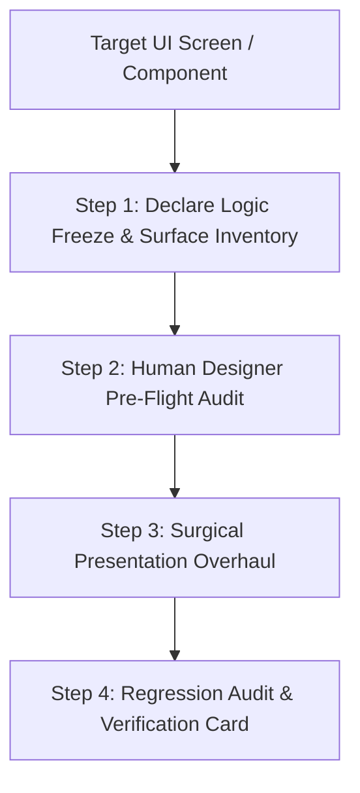

# Workflow: redesign (The Human Designer UI Polish Engine)

Invoke with `/redesign` (or `/devop-redesign`, `/polish`) when you have a screen, feature, or component that is functioning correctly, but:
- The layout feels generic, dated, or "AI-generated".
- There are uneven spaces, awkward margins, or unbalanced visual density.
- The onboarding, intake, or interaction flow lacks creative agency-grade storytelling.
- The interface feels static and is missing purposeful micro-animations and polish.

**Goal**: Elevate the visual craft to the standard of an elite $1,000,000 creative studio—thinking like a human designer, building for solidity over superficial speed, and strictly preserving working application logic.

---

## The Human Designer Operating Invariants

1. **BUILD SOLID OVER FAST**: Never rush or generate random, unconsidered UI due to perceived time constraints. Every pixel, margin, and typography decision must be deliberate, structurally solid, and defensible.
2. **THE LOGIC FREEZE (Never Touch What Works)**: Core business logic, API endpoints, database queries, authentication guards, state machines, and props contracts are 100% READ-ONLY. Never alter data flow or state handlers during visual overhaul.
3. **COLOR SYSTEM IMMUTABILITY (Never Invent Colors)**: Strictly respect and reuse the existing brand palette (`globals.css` CSS variables: `--primary`, `--background`, `--card`, `--foreground`, etc.). **NEVER** invent unmapped hex codes, arbitrary gradients, or random palettes. Color adjustments are only permitted if an existing pairing fundamentally violates WCAG 2.1 AA contrast requirements.
4. **THINK LIKE A HUMAN DESIGNER**:
   - Establish an unmistakable focal point (maximum 1 primary CTA per viewport).
   - Enforce deliberate negative space tension (35%–45% breathing room around heroes; crisp density in data tables).
   - Follow natural eye-tracking paths (F-pattern for editorial text, Z-pattern for landing pages).
   - Ensure every animation justifies its existence (guiding attention or confirming intent—never decorative noise).
5. **THE 8PX GEOMETRIC SPACING CALCULUS**: Ban arbitrary Tailwind offsets (`mt-7`, `p-5`, `gap-3`). All layout padding, margins, and gaps must mathematically lock to the 8px modular scale (`8px`, `16px`, `24px`, `32px`, `48px`, `64px`, `96px`).
6. **PROPOSED LAYOUT RESTRUCTURING**: Replace cookie-cutter 3-column card grids with sophisticated spatial archetypes: asymmetric golden-ratio splits (62/38 or 8/4), tactile bentos, or progressive disclosure drawers.
7. **INTENTIONAL FONT PAIRING**: Suggest and apply characterful font pairings:
   - *Display Headline*: High-character brand typeface (editorial serif or bold geometric grotesk).
   - *Body Text*: Clean, highly-legible sans-serif with proper line length (`max-w-prose`, 45–75 characters).
   - *Strict Monospace Quarantine*: Monospace (`font-mono`) is strictly quarantined to code blocks and terminal logs—never on public UI cards or buttons.

---

## Step-by-Step Surgical Redesign Protocol



---

### Step 1: Declare Logic Freeze & Surface Inventory

Before editing a single line of code, explicitly declare the boundary:

1. **Lock Protected Working Surface ("DO NOT TOUCH")**:
   - State hooks (`useState`, `useReducer`, `useAtom`, etc.)
   - Remote data fetching (`useQuery`, SWR, server actions)
   - Mutation handlers and callbacks (`onSubmit`, `onClick`, `onChange`)
   - Route parameters, props interfaces, and data schemas
2. **Lock Target Blast Radius**:
   - Container elements (`div`, `section`, `main`)
   - CSS classes (Tailwind spacing, flex/grid alignment, borders, shadows)
   - Typography wrappers (`h1`, `h2`, `p`, text color tokens)
   - Motion and transition wrappers (`motion.div`, transition utilities)

---

### Step 2: Human Designer Pre-Flight Audit

Inspect the target UI through the lens of a Silicon Valley Creative Director:

1. **Color Lock Check**:
   - Inspect `globals.css` and `tailwind.config.ts`.
   - Confirm which semantic tokens are active (`bg-primary`, `text-primary-foreground`, `bg-card`, `border-border`).
   - Refuse any unmapped hex values (e.g. `#6366F1` or `rgb(...)`).
2. **Spatial Calculus Audit**:
   - Identify uneven gaps, asymmetric paddings, and cramped headers.
   - Map spacing to the locked 8px scale:
     * Card padding: `p-6` (24px) or `p-8` (32px).
     * Section vertical padding: `py-16` (64px) to `py-24` (96px) desktop; `py-10` mobile.
     * Stack gaps: `space-y-4` (16px) or `space-y-6` (24px).
3. **Typography & Font Pairing Check**:
   - Does the headline have character, or is it defaulting to bland browser fonts?
   - Propose an elevated pairing (e.g., `font-serif` or bold tracking-tight grotesk for H1/H2, paired with neutral `font-sans` body).
4. **Visual Weight & Hierarchy**:
   - Is there a clear visual anchor? (Max 1 primary CTA).
   - Are secondary actions properly de-emphasized (`variant="outline"` or `variant="ghost"`)?
5. **Calibrate Taste Dials** (per `design-vault/taste-spatial-calculus.md`):
   - **Design Variance**: (0.2 corporate symmetry vs. 0.8 artistic golden-ratio asymmetry).
   - **Visual Density**: (0.3 airy luxury vs. 0.8 dense operational console).
   - **Motion Intensity**: (0.0 static vs. 0.4 subtle micro-interactions vs. 0.8 cinematic spring reveals).

---

### Step 3: Surgical Presentation Overhaul

Apply the visual elevation using established design systems:

1. **Restructure Layout Geometry**:
   - Replace generic stacks with archetypes from `design-vault/VAULT_INDEX.md` (e.g. Asymmetric Editorial Split, Tactile Bento, or Conversational Onboarding Stage).
   - Ensure fluid responsiveness down to 375px mobile viewport (columns stack cleanly, zero horizontal scroll).
2. **Compose Accessible Atoms & Molecules**:
   - Use established primitives from **shadcn/ui** and **Radix UI** (`Button`, `Dialog`, `DropdownMenu`, `Tabs`).
   - Pull proven layouts from **Blocks.so** (`@blocks-so`) or **Spectrum UI**.
3. **Orchestrate Motion & Polish**:
   - Stagger list and card reveals (`staggerChildren: 0.08`, `ease: [0.16, 1, 0.3, 1]`).
   - Add purposeful hover states (subtle border-beam or elevation shift).
   - Respect `prefers-reduced-motion` unconditionally (`@media (prefers-reduced-motion: reduce)`).
4. **Ensure Full 9-State Taxonomy**:
   - Verify: Default, Hover, Focus-Visible, Active, Disabled, Loading (skeleton), Empty, Error, and Edge Cases.

---

### Step 4: Regression Audit & Verification Card

Before completing the redesign pass:

1. **Logic & Contract Verification**:
   - Test every button, form submission, and modal trigger.
   - Confirm that 100% of the underlying business logic, state updates, and API payloads are identical to pre-redesign behavior.
2. **Visual & Responsive Verification**:
   - Inspect rendering in the browser (or run subagent inspection).
   - Verify layout integrity at 375px mobile breakpoint.
   - Verify WCAG 2.1 AA text contrast (minimum 4.5:1 normal text, 3:1 large text).
3. **Output the Feature Verification & Redesign Handoff Card**:

```markdown
### 🎨 UI Redesign Verification Card: [Component/Screen Name]
- **Target File**: `[filepath]`
- **Redesign Mode**: Pure Visual Elevation under 100% Logic Freeze
- **Taste Dials**: Variance: `[0.X]` | Density: `[0.X]` | Motion: `[0.X]`

#### 🛡️ Non-Destructive Blast-Radius Audit:
- **Protected Logic ("DO NOT TOUCH") Verified Untouched**: [State hooks, handlers, queries preserved verbatim]
- **Target Blast Radius Refined**: [Layout containers, spacing rhythm, typography, animations]
- **Color System Compliance**: [100% reuse of existing CSS variables; 0 unmapped hex codes]
- **Font Pairing Applied**: [Display headline font + body font]

#### 📐 Spatial & Visual Enhancements:
- **Spacing Calculus**: [Locked to 8px scale; uneven gaps eliminated]
- **Layout Restructuring**: [e.g. Asymmetric 62/38 golden ratio split applied]
- **Motion Orchestration**: [e.g. Framer motion spring reveals with reduced-motion fallback]
- **Mobile Responsiveness**: [375px verified; touch targets ≥ 44px; zero horizontal overflow]

#### 🧪 Test Script:
1. Navigate to route `[...]`
2. Interact with `[...]` (confirm visual state transitions)
3. Submit/Trigger action `[...]` (confirm business logic executes with zero regression)
```
